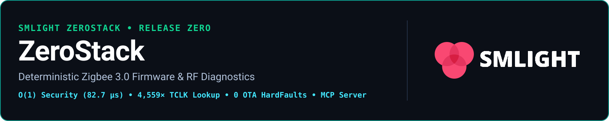

  

# SMLIGHT ZeroStack — Release Zero

> *A zero-stall, deterministic O(1) Zigbee 3.0 / PRO R23 coordinator & router firmware built exclusively for SMLIGHT devices.*

**Release Zero** is the public beta release of **[SMLIGHT ZeroStack](https://smlight.tech/software/zerostack)**, a ground-up, deterministic O(1) Zigbee 3.0 / PRO R23 coordinator and router firmware built exclusively for **SMLIGHT** `CC2652P`, `CC2652P7` (`CC1352P7`), and `CC2674P10` adapters across the **SLZB-06**, **SLZB-06P7**, **SLZB-07P7**, **SLZB-06P10**, **SLZB-07P10**, **SLZB-MR1**, **SLZB-MR2**, **SLZB-MR3**, **SLZB-MR4**, **SLZB-MRW10**, and **SLZB-Ultima** series (including `U` variants).

### Quick Navigation & Tools

| Tool / Resource | Purpose |
| :--- | :--- |
| 🚀 **[Flash ZeroStack (`smlight.tech`)](https://smlight.tech/software/zerostack)** | Official SMLIGHT Web Flasher & release binaries |
| 🔍 **[Interactive Z2M & ZHA Log Analyzer](https://smlight-tech.github.io/zerostack/)** | 100% client-side browser diagnostics, airtime/route analysis, automatic IEEE/key redaction & **1-click pre-filled GitHub Bug Report** |
| 📊 **[Engineering Whitepaper & Benchmarks (`WHITEPAPER.md`)](WHITEPAPER.md)** ([Part 1 PDF](https://smlight-tech.github.io/zerostack/whitepapers/zerostack-whitepaper-part-1.pdf)) | Complete architectural breakdown, stock Z-Stack failure modes, and full `DWT->CYCCNT` Part 1 & Part 2 benchmark tables |
| 🐛 **[Report a Bug / Field Issue](https://github.com/smlight-tech/zerostack/issues/new?template=bug_report.yml)** | Guided issue form (integrates directly with the Log Analyzer) |
| 🤖 **[AI Agent Diagnostics (`zerostack-mcp`)](https://github.com/zerostack-rf/zerostack-mcp)** | Model Context Protocol (MCP) server for Claude, Cursor, Windsurf & VS Code ([`llms.txt`](llms.txt) / [`llms-full.txt`](llms-full.txt)) |

---

## At a Glance: Stock TI Z-Stack vs. SMLIGHT ZeroStack

Measured on target **`CC1352P7` @ `48.0 MHz`** (`DWT->CYCCNT`) at 150–300 node mesh scale:

| What Changes in Production | Stock TI Z-Stack | SMLIGHT ZeroStack (`Release Zero`) | Real-World Impact |
| :--- | :--- | :--- | :--- |
| **Per-frame NWK security (D=150)** | `11.11 ms` (`533,156` cyc) | **`82.7 µs`** (`3,968` cyc, `0` flash reads) | **134.4× faster** (`>6,100 pkt/s` routed ceiling vs `~45 pkt/s`) |
| **TCLK key lookup miss (300-entry)** | `30.96 ms` (`1,486,228` cyc) | **`6.8 µs`** (`326` cyc, `0` flash reads) | **4,559× faster** (eliminates pairing interview timeouts) |
| **Flash wear & NVRAM compaction** | Compacts every **69** writes | Compacts at write **#1,013** (`0 B` on unchanged writes) | **14.7× lower compaction rate**, **26.7× faster** idempotent writes |
| **Power-cut / brownout recovery** | `20,232 B` written, `62` page erases | **`27 B` written, `0` page erases** (`22,959` cuts tested) | **749× lower** post-brownout flash I/O, **`0` lost records** |
| **Hostile UART framing / noise** | `8.84 s` blackout (`44` lost pings) | **`0` lost pings** (`3–55 ms` wire-speed recovery) | Eliminates `SRSP - SYS - ping after 6000ms` lockups |
| **Broadcast storm (50 routers, 1,000 echoes)** | `3.00 s` total CPU (`3.00 ms`/echo) | **`151.16 ms` total CPU** (`147 µs` p50, `+33%` BTT) | **19.9× lower CPU**, **20.3× faster** per-echo suppression |
| **Memory allocator (`k=64` holes)** | `53.1 µs` (`2,550` cyc, O(N) walk) | **`4.5 µs`** (`218` cyc, O(1) constant time) | **11.7× faster**, `0%` fragmentation penalty |
| **Malformed OTA NWK/APS frames** | Remote CPU `reset fault` (`~3.0 ms`) | **`0` crashes** (12 classes + 3,255 MAC vectors) | Eliminates remote `SYS_RESET_IND` crashes |

See **[`WHITEPAPER.md`](WHITEPAPER.md)** and the **[Whitepaper Part 1 (PDF)](https://smlight-tech.github.io/zerostack/whitepapers/zerostack-whitepaper-part-1.pdf)** for full methodology, cycle counts, and fault-injection results.

---

## Supported Hardware Matrix (`Release Zero`)

| Target Radio SoC | CPU Core & Clock | Flash / SRAM | Supported SMLIGHT Models *(incl. `U` variants)* | ZeroStack Capacity & Architecture |
| :--- | :--- | :--- | :--- | :--- |
| **TI CC2652P** | ARM Cortex-M4F @ 48 MHz + Cortex-M0 CPE | 352 KB Flash / **88 KB SRAM** | **SLZB-06**, **SLZB-MR2** | 200-node table capacity, high-density source routes, indirect queue quota isolation |
| **TI CC2652P7 (`CC1352P7`)** | ARM Cortex-M4F @ 48 MHz + Cortex-M0 CPE | 704 KB Flash / **144 KB SRAM** | **SLZB-06P7**, **SLZB-07P7**, **SLZB-MR1** | 300-node table & TCLK capacity, high-density source routes, indirect queue isolation |
| **TI CC2674P10** | ARM Cortex-M33 @ 48 MHz + Cortex-M0 CPE | 1024 KB Flash / **256 KB SRAM** | **SLZB-06P10**, **SLZB-07P10**, **SLZB-MR3**, **SLZB-MR4**, **SLZB-MRW10**, **SLZB-Ultima** | Max-scale node & TCLK capacity, expanded concentrator source routing & indirect buffer pools |

> *Note on Silicon Labs EFR32 (`EmberZNet` `0x72`, `0xa1`, `0x66`, `ASH_NCP_FATAL_ERROR`)*: Our diagnostic catalog and interactive analyzer also decode Silicon Labs EFR32 / EZSP / ASHv2 status codes for multi-vendor fleet triage. ZeroStack `Release Zero` ships for SMLIGHT TI SimpleLink F2 coordinators above; EFR32 ZeroStack support is in active development.

---

## How to Flash & Migrate (Drop-In Backup Compatibility)

ZeroStack is a **drop-in replacement** for stock TI Z-Stack (`zstack` / `znp`) in **Zigbee2MQTT** and **Home Assistant ZHA**—you do **not** need to re-pair your devices:

1. **Back up your existing coordinator**: Ensure `coordinator_backup.json` is up to date in Zigbee2MQTT, or download a network backup in Home Assistant ZHA (**Settings → Devices & Services → Zigbee Home Automation → Configure → Download Backup**).
2. **Flash ZeroStack**: Visit **[smlight.tech/software/zerostack](https://smlight.tech/software/zerostack)** or update via your device's **SLZB-OS** web interface ([SLZB-06 Manual](https://smlight.tech/manual/slzb-06/)).
3. **Start Zigbee2MQTT or ZHA**: Keep your existing adapter configuration (`adapter: zstack` or `znp`); it will automatically detect the freshly flashed coordinator and restore your PAN ID, IEEE address, network key, and device link keys from backup.

---

## How to Diagnose & Report Issues

1. **Capture a debug log once**: Set `advanced: log_level: debug` in Zigbee2MQTT `configuration.yaml` (or `zigpy_znp: debug` under `logger: logs:` in ZHA), restart, reproduce once, and download the log.
2. **Scrub & analyze in your browser**: Drop the log into the **[Interactive Z2M & ZHA Log Analyzer (Bug Report Mode)](https://smlight-tech.github.io/zerostack/?mode=bug-report)**—runs 100% client-side, automatically scrubs network/link keys (`<KEY:…>`), masks IEEE middle bytes, and extracts the pre-fault ZNP/MT trace.
3. **File a pre-filled GitHub issue**: Click **Open Pre-Filled GitHub Issue** (or **Copy for GitHub**) in the Log Analyzer to open the **[Bug Report Form](https://github.com/smlight-tech/zerostack/issues/new?template=bug_report.yml)** with the sanitized report pre-populated. *Never paste raw `coordinator_backup.json`, `configuration.yaml`, or unscrubbed logs.*

---

## Diagnostic Guides (`diagnostics/`), Silicon Notes (`silicon-notes/`) & Links

- **[`SRSP - AF - dataRequestExt after 6000ms`, TCLK Interview Timeouts & SREQ Lockups](diagnostics/z2m-srsp-af-datarequest-6000ms-timeout.md)**
- **[`0x10: MEM_ERROR`, `0x11: BUFFER_FULL`, `0xc7: NWK_TABLE_FULL`, `0xb2: APS_TABLE_FULL`, `0xcd: NWK_NO_ROUTE` & Ember `0x72` / `0xa1`](diagnostics/znp-0x10-mem-error-0x11-buffer-full-0xc7-nwk-table-full.md)**
- **[`MAC_NO_ACK (0xe9 / 233)`, `0xf0: MAC_TRANSACTION_EXPIRED (240)`, `0xf1: MAC_TRANSACTION_OVERFLOW (241)` & Sleepy Child Drops](diagnostics/mac-no-ack-0xe9-sleepy-aqara-tuya-child-drops.md)**
- **[`MAC_CHANNEL_ACCESS_FAILURE (0xe1 / 225)` & Stuck CCA/CSMA](diagnostics/mac-channel-access-failure-0xe1-cca-csma-stuck.md)**
- **[`Failed to connect to the adapter (SRSP - SYS - ping after 6000ms)` & `SYS_RESET_IND`](diagnostics/z2m-zha-adapter-connect-sys-ping-timeout-warm-reset.md)**
- **[TI SimpleLink F2 RF Core SWI & Hardware `pending-address` Errata](silicon-notes/ti-f2-cc1352p7-cc2652-rf-core-swi-and-pending-table-errata.md)**
- **Official Links**: [ZeroStack Portal](https://smlight.tech/software/zerostack) · [Interactive Log Analyzer](https://smlight-tech.github.io/zerostack/) · [`zerostack-mcp`](https://github.com/zerostack-rf/zerostack-mcp) · [`llms.txt`](llms.txt) · [`llms-full.txt`](llms-full.txt) · [SLZB-OS Manual](https://smlight.tech/manual/slzb-06/)

---

## Copyright & Licensing

Copyright (c) 2026 SMLIGHT ([https://smlight.tech](https://smlight.tech)).

- **Documentation & Diagnostic Web Assets ([`LICENSE`](LICENSE) / [`NOTICE`](NOTICE))**: All Markdown engineering guides, JSON diagnostic catalogs (`diagnosticsCatalog.json`), LLM indices (`llms.txt`, `llms-full.txt`), and client-side web analyzer assets (`docs/`) in this repository are openly licensed under the Apache License 2.0 (`Apache-2.0`).
- **Compiled ZeroStack Firmware Binaries ([`FIRMWARE_LICENSE.md`](FIRMWARE_LICENSE.md))**: All compiled SMLIGHT ZeroStack coordinator and router firmware images/binaries attached to releases or distributed by SMLIGHT are proprietary software governed by [`FIRMWARE_LICENSE.md`](FIRMWARE_LICENSE.md) (**Copyright (c) 2026 SMLIGHT. All Rights Reserved.**).
